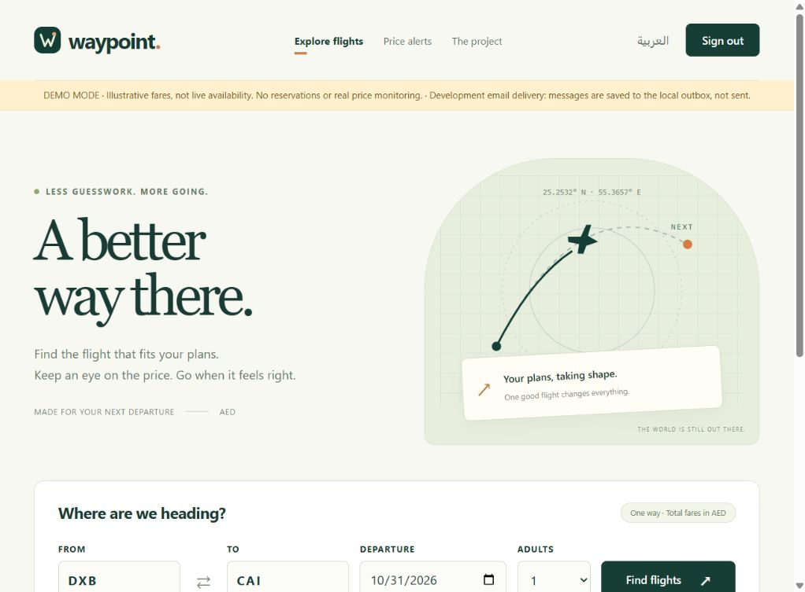
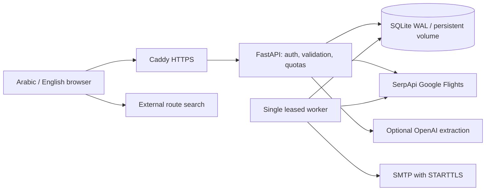

# Waypoint — Flight discovery & price alerts

A personal engineering project that turns a Streamlit prototype into a deployable web application. English and Arabic UI, one-way flight comparison in AED, isolated accounts, scheduled email alerts, and optional natural-language search input.

**Release status:** implemented and locally tested; not yet deployed or verified against live flight, AI, or SMTP accounts. See [release evidence](docs/RELEASE.md) for measured checks and remaining release gates. Do not describe it as a live production service until those gates pass.



## What it does

- Authenticated flight searches through SerpApi Google Flights, with dates, airports, passengers, airline, cabin, nonstop and total budget validation.
- Combines and deduplicates results; sorts by price or duration. Errors remain distinct from zero results.
- Caches matching searches for 10 minutes and enforces per-account, per-IP and global provider limits.
- Stores accounts separately, hashes passwords using scrypt, hashes session/reset tokens, verifies email and supports password reset/account deletion.
- Watches up to three routes per account; a separate worker checks every 12 hours by default and delivers matching-price emails through a persistent outbox.
- Optional OpenAI structured extraction fills a search form. Users review it before searching. The model never executes searches, charges cards or writes alerts.
- Opens a Google Flights **route search** externally. No claimed partnership, fixed-offer checkout, payment, ticket issuance, calendar access or weather forecasting.

## Local setup (Python 3.13)

```powershell
python -m venv .venv
.\.venv\Scripts\python -m pip install -r requirements-dev.txt
```

Copy `.env.example` to `.env` **only if you do not already have `.env`**; otherwise merge the documented settings and preserve existing credentials. Never commit secrets. The old `agent_v2.db` is left untouched. New data is stored in `data/travel.db`; the old shared-user data is intentionally not imported into new accounts.

For an explicitly labelled local demonstration without paid API calls:

```powershell
$env:APP_ENV = "development"
$env:FLIGHT_PROVIDER = "demo"
$env:OPENAI_API_KEY = ""
$env:SERP_API_KEY = ""
$env:SMTP_HOST = ""
.\.venv\Scripts\python -m uvicorn app:create_app --factory --host 127.0.0.1 --port 8000 --no-access-log --log-config logging.json
```

Open `http://127.0.0.1:8000`. Register with a 12–128 character password and matching confirmation. After submitting, the form switches to sign-in and keeps your email. Error messages follow the selected UI language. Sign in to search; email verification is required for price alerts only. In a second terminal, run the worker with the same configuration:

```powershell
.\.venv\Scripts\python worker.py
```

Without SMTP in development, queued verification/reset/alert emails are written to `data/dev-mail.jsonl`. Open the verification link there to test alerts. The file contains private links: keep it local. Demo fares are illustrative, not live inventory, and demo mode is rejected in production.

For real search, set `FLIGHT_PROVIDER=live` and `SERP_API_KEY`. Set `OPENAI_API_KEY` only if you want AI form input. `OPENAI_MODEL` defaults to `gpt-4o-mini`. Never substitute demo prices on provider failure. Live tests may consume provider credits and are deliberately outside the offline test suite.

## Architecture



`app.py` owns the HTTP boundary; `models.py` owns input rules; `database.py` owns persistence; `tools.py` owns flight-provider normalization; `main.py` owns optional AI extraction; `worker.py` owns scheduling; `mailer.py` owns delivery. All prices are AED totals for selected adult passengers. Times are shown as supplied in airport local time. Departure validation uses Asia/Dubai.

## Checks

```powershell
python -m ruff check .
python -m ruff format --check .
python -m pytest --cov=app --cov=database --cov=tools --cov=main --cov=worker --cov=security --cov=settings --cov=models --cov=mailer --cov-report=term-missing --cov-fail-under=85
python -m pip_audit -r requirements.lock --no-deps --disable-pip
python scripts/load_test.py --base-url http://127.0.0.1:8000 --requests 200 --concurrency 10
```

Tests use temporary real SQLite databases and mock external HTTP/SMTP boundaries. The load script measures public home/session routes only; it does not establish flight-search capacity or 5,000 concurrent users. GitHub Actions runs lint, format, tests, dependency audit, image build and Compose configuration validation.

## Deployment and project presentation

- [Deployment, configuration, backups and recovery](docs/DEPLOYMENT.md)
- [Release evidence and remaining gates](docs/RELEASE.md)
- [Engineering case study](docs/CASE_STUDY.md)
- [LinkedIn project description and draft post](docs/LINKEDIN.md)

The supported initial deployment is **one host, one web process and one worker with a shared local persistent SQLite volume**. Multiple hosts, network-mounted SQLite, ticket sales and payment processing are outside this release. See the deployment guide before public exposure.

## Provider documentation

- [SerpApi Google Flights parameters](https://serpapi.com/google-flights-api)
- [OpenAI structured outputs](https://developers.openai.com/api/docs/guides/structured-outputs?api-mode=chat)

## ملخص بالعربية

مشروع شخصي لاكتشاف رحلات الطيران ومقارنة الأسعار ومتابعتها، مع واجهة عربية وإنجليزية وحسابات مستقلة وتنبيهات بريدية. الإدخال بالذكاء الاصطناعي اختياري ويحتاج مراجعة المستخدم قبل البحث. لا يستقبل التطبيق مدفوعات ولا يصدر تذاكر. الكود مختبر محليًا ومجهز للنشر؛ وصفه بأنه يعمل في Production يتطلب إتمام النشر والتحقق من الخدمات الحقيقية الموضحة في تقرير الإصدار.
